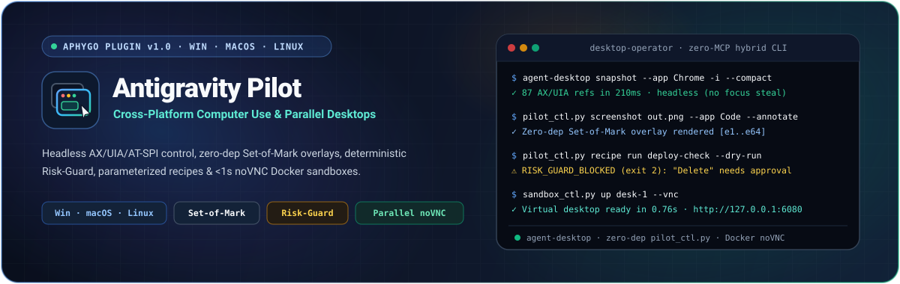
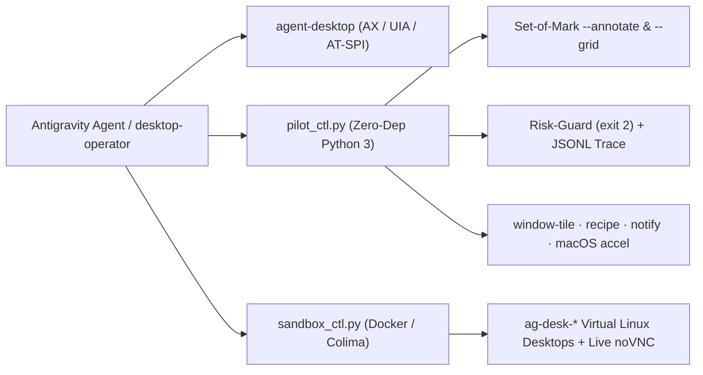

<div align="center">



<br />

# Antigravity Pilot (`antigravity-pilot`)

**Cross-platform desktop computer use and `<1s` parallel virtual desktops for Google Antigravity — on Windows, macOS, and Linux, with zero MCP token bloat.**

[](plugin.json)
[](#why-hybrid-cli-instead-of-a-heavy-mcp-server)
[](#platform-support-matrix)
[](#security-guardrails)
[](LICENSE)

[Highlights](#highlights) · [Platform Matrix](#platform-support-matrix) · [Architecture](#why-hybrid-cli-instead-of-a-heavy-mcp-server) · [Quick Start](#quick-start) · [CLI Reference](#cli-quick-reference) · [Parallel Sandboxes](#parallel-desktop-automation) · [Security](#security-guardrails)

</div>

---

> **Control any native desktop without burning thousands of context tokens on bloated MCP tool schemas.**
>
> **Antigravity Pilot** unites Vercel Labs **`agent-desktop`** (headless `AX` / `UIA` / `AT-SPI` accessibility trees), zero-dependency Python **`pilot_ctl.py`** (Set-of-Mark `--annotate` & `--grid` overlays, deterministic **Risk-Guard** + JSONL audit traces, multi-display `window-tile`, parameterized `recipe` workflows, and native notifications), and **`sandbox_ctl.py`** (`<1s` Docker virtual Linux desktops with live **noVNC** human-in-the-loop takeover) — backed by the autonomous **`desktop-operator`** subagent.

---

## Highlights

- **Cross-Platform Headless Control (`agent-desktop`):** Drives native apps on **Windows (`UIA`)**, **macOS (`AX`)**, and **Linux (`AT-SPI`)** without stealing focus or moving the cursor, with qualified `@<snapshot_id>:e<N>` stale-ref protection, Chromium/Electron accessibility, overlay surfaces, `wait`, `batch`, and `--stdin` secret piping.
- **Zero-Dependency Set-of-Mark (`--annotate` & `--grid`):** `pilot_ctl.py screenshot` renders crisp bounding boxes, numbered interactive refs (`e1..eN`), and optional coordinate grids directly onto PNGs using pure Python standard library — giving agents reliable visual grounding on canvas, WebGL, and custom views across all three OSes.
- **Deterministic Risk-Guard & JSONL Audit Traces:** `guard-check`, `safe-click`, `safe-close`, and `recipe run` deterministically block destructive or external-send actions with exit code **`2`** (`RISK_GUARD_BLOCKED`) unless `--confirm-risky` is explicitly passed after user approval. Record compact JSONL audit logs with `--trace <file.jsonl>` or `PILOT_CTL_TRACE`.
- **Parameterized Recipes & Multi-Display Tiling:** Store, inspect, `--dry-run`, and replay parameterized workflows (`--param key=val`) with `pilot_ctl.py recipe`, and snap windows across multiple monitors with `pilot_ctl.py window-tile ... --display <1-based>`.
- **`<1s` Parallel Virtual Desktops + Live noVNC (`sandbox_ctl.py`):** Launch isolated Docker/Colima virtual Linux desktops (`ag-desk-*`) from Windows, macOS, or Linux with optional browser-accessible live **noVNC** (`up <name> --vnc` + `url <name>`) for seamless human takeover during 2FA, SSO logins, or CAPTCHAs.

---

## Platform Support Matrix

| Capability | Windows 10/11 | macOS 13+ | Linux (X11 / Wayland) | Engine |
| :--- | :---: | :---: | :---: | :--- |
| **Headless Accessibility Tree (`snapshot`, `click`, `type`, `wait`, `batch`)** | ✅ (`UIA`) | ✅ (`AX`) | ✅ (`AT-SPI`) | `agent-desktop` |
| **Zero-Dep Set-of-Mark (`screenshot --annotate --grid`)** | ✅ | ✅ | ✅ | `pilot_ctl.py` |
| **Deterministic Risk-Guard (`guard-check`, `safe-click`, `safe-close`) & JSONL Trace** | ✅ | ✅ | ✅ | `pilot_ctl.py` |
| **Multi-Display Window Tiling (`window-tile --display <N>`)** | ✅ | ✅ | ✅ | `pilot_ctl.py` |
| **Parameterized Recipes (`recipe list\|show\|save\|run\|delete`)** | ✅ | ✅ | ✅ | `pilot_ctl.py` |
| **Native Desktop Notifications (`notify`) & Readiness (`doctor`)** | ✅ | ✅ | ✅ | `pilot_ctl.py` |
| **Parallel Virtual Linux Desktops + Live noVNC (`up --vnc`, `url`, `exec`)** | ✅ (Docker) | ✅ (Docker / Colima) | ✅ (Docker) | `sandbox_ctl.py` |
| **Live Demo Recording (`record`) & Apple Shortcuts (`shortcut`)** | — | ⚡ Native Accelerator | — | `pilot_ctl.py` → `bin/macos-ctl` |

> **Honest note on macOS Native Accelerators:** `record` (capturing live user mouse/keyboard demos into recipe JSON via macOS Input Monitoring) and `shortcut` (running Apple Shortcuts) are macOS-only accelerators delegated automatically through the compiled Swift binary `bin/macos-ctl`. Every other capability — including headless control, Set-of-Mark overlays, Risk-Guard, audit traces, multi-display tiling, `recipe save/run`, `notify`, and live noVNC sandboxes — runs natively on **Windows, macOS, and Linux**.

---

## Why Hybrid CLI Instead of a Heavy MCP Server?

Typical desktop-control MCP servers inject **50+ tool schemas** into every conversation turn, burning thousands of context tokens before the agent even reads your prompt.

**Antigravity Pilot** uses a **zero-MCP hybrid CLI stack** instead:



1. **Primary Engine — `agent-desktop` (Vercel Labs):** Headless-first semantic accessibility engine with qualified `@<snapshot_id>:e<N>` refs, Chromium/Electron support, overlay surfaces, `wait`, `batch`, `--stdin` secret piping, and built-in `POLICY_DENIED` quit guards.
2. **Complement Engine — `pilot_ctl.py` (Zero-Dep Python 3):** Cross-platform Set-of-Mark rendering, deterministic Risk-Guard + JSONL trace logging, multi-display window tiling, parameterized recipes, native notifications, and seamless macOS Swift acceleration (`bin/macos-ctl`).
3. **Virtual Desktop Engine — `sandbox_ctl.py`:** Launches `<1s` isolated virtual Linux desktops (`antigravity-desktop-sandbox:latest`, prefix `ag-desk-*`) with optional live **noVNC** so parallel subagents never fight over host focus, cursor, or clipboard.
4. **Autonomous Subagent — `desktop-operator`:** Runs multi-step *Observe → Act → Verify* loops in an isolated subagent context with hard safety stops, keeping your main conversation clean.

---

## Quick Start

### Prerequisites

- **Python 3.9+** (standard library only — zero `pip` dependencies required for `pilot_ctl.py` and `sandbox_ctl.py`)
- **Vercel Labs `agent-desktop`** on your `PATH` (installed or verified by the installer)
- **Docker** or **Colima** (optional — only needed for Level 2 parallel virtual desktops via `sandbox_ctl.py`)
- **macOS optional:** Xcode Command Line Tools (`swift`) if compiling the native `bin/macos-ctl` accelerator for `record` and `shortcut`

### macOS & Linux (Bash / Zsh)

```bash
git clone https://github.com/Aphygo/antigravity-pilot.git \
  "$HOME/.gemini/config/plugins/antigravity-pilot"

cd "$HOME/.gemini/config/plugins/antigravity-pilot"
./scripts/install.sh
```

### Windows (PowerShell)

```powershell
git clone https://github.com/Aphygo/antigravity-pilot.git `
  "$HOME\.gemini\config\plugins\antigravity-pilot"

cd "$HOME\.gemini\config\plugins\antigravity-pilot"
.\scripts\install.ps1
```

### Verify Permissions & Readiness

**macOS & Linux:**
```bash
agent-desktop permissions
python3 "$HOME/.gemini/config/plugins/antigravity-pilot/scripts/pilot_ctl.py" doctor
```
*(If macOS Accessibility or Screen Recording is missing, run `agent-desktop permissions --guide`.)*

**Windows (PowerShell):**
```powershell
agent-desktop status
python "$HOME\.gemini\config\plugins\antigravity-pilot\scripts\pilot_ctl.py" doctor
```

---

## CLI Quick Reference

### `pilot_ctl.py` (Cross-Platform Complement CLI)

Run via `python3 "$HOME/.gemini/config/plugins/antigravity-pilot/scripts/pilot_ctl.py"` (or `bin/pilot-ctl` on macOS/Linux) or `python "%USERPROFILE%\.gemini\config\plugins\antigravity-pilot\scripts\pilot_ctl.py"` on Windows.

| Command | Purpose |
| :--- | :--- |
| `doctor [--json]` | Inspect OS backend, `agent-desktop`, permissions, Docker, and macOS accelerator status. |
| `screenshot <out.png> [--app <App>] [--window-id <id>] [--screen <idx>] [--annotate] [--grid] [--max-depth <N>] [--limit <N>] [--session <S>] [--agent-id <A>] [--json]` | Zero-dependency screenshot with Set-of-Mark (`--annotate`) interactive bounding boxes/refs and/or coordinate `--grid`. |
| `window-tile <app> <left\|right\|top\|bottom\|maximize\|center> [--window-id <id>] [--title <substr>] [--display <1-based>] [--json]` | Snap an app window to halves, centered, or maximized layout on a chosen display. |
| `guard-check <action> <target> [--json]` | Check whether an action/target trips deterministic Risk-Guard (exit `2` + `RISK_GUARD_BLOCKED`). |
| `safe-click <ref> [--label <text>] [--app <App>] [--headed]` | Click a qualified ref through Risk-Guard enforcement. |
| `safe-close <app> [--force]` | Close an app cleanly through Risk-Guard (`--force` requires `--confirm-risky`). |
| `recipe list\|show\|save\|run\|delete` | Manage and execute parameterized recipes (`--param key=val`, `--dry-run`, `--stdin`, `--confirm-risky`). |
| `notify <title> <message>` | Show a native desktop notification on Windows, macOS, or Linux. |
| `record [--duration <sec>] [--output <file>] [--app <name>]` | *(macOS accelerator)* Record live mouse/keyboard demos into recipe JSON. |
| `shortcut <name> [--input <text>]` | *(macOS accelerator)* Run an Apple Shortcut by name. |

**Global flags:** `--confirm-risky` (only after explicit user approval) and `--trace <file.jsonl>` (or environment variable `PILOT_CTL_TRACE=<file.jsonl>`).

---

## Parallel Desktop Automation

`antigravity-pilot` supports two complementary levels of parallelism:

### Level 1 — Host Multi-Worker Sessions (`agent-desktop`)

Isolate concurrent workers on the host desktop with `--session` and `--agent-id`:

```bash
agent-desktop --session batch-1 --agent-id worker-a \
  snapshot --app "Google Chrome" --window-id w-101 -i --compact

agent-desktop --session batch-1 --agent-id worker-b \
  snapshot --app "Google Chrome" --window-id w-205 -i --compact
```

> **Multi-window gotcha:** On multi-window apps like Chrome, Edge, Finder, or Explorer, always pass `--app "<App>"` and `--window-id <id>` together so each worker stays pinned to its intended window.

### Level 2 — Parallel Virtual Desktops + Live noVNC (`sandbox_ctl.py`)

When parallel agents need fully isolated displays, clipboards, and application state across Windows, macOS, or Linux, run virtual Linux desktops in Docker/Colima (`antigravity-desktop-sandbox:latest`, container prefix `ag-desk-*`):

```bash
# macOS / Linux (on Windows, invoke with: python scripts\sandbox_ctl.py ...)
SANDBOX="python3 $HOME/.gemini/config/plugins/antigravity-pilot/scripts/sandbox_ctl.py"

# 1. Build the sandbox image once (add --with-chromium for browser workflows)
$SANDBOX build --with-chromium

# 2. Spin up isolated virtual desktops (<1s each), optionally with live noVNC
$SANDBOX up desk-1 --vnc --vnc-port 6081
$SANDBOX up desk-2

# 3. Get the live noVNC URL for human-in-the-loop takeover (e.g. 2FA / login)
$SANDBOX url desk-1

# 4. Run agent-desktop commands inside each virtual desktop
$SANDBOX exec desk-1 status
$SANDBOX exec desk-2 snapshot -i --compact

# 5. Inspect or tear down sandboxes
$SANDBOX list --json
$SANDBOX down desk-1
$SANDBOX down-all
```

---

## Security Guardrails

Both the always-on rules (`rules/AGENTS.md`) and the `desktop-operator` subagent (`agents/desktop-operator.md`) enforce hard safety boundaries:

- **Headless by default:** Semantic accessibility calls never steal focus or move the cursor unless `--headed` is explicitly required and permitted.
- **Deterministic Risk-Guard (`RISK_GUARD_BLOCKED`, exit `2`):** `pilot_ctl.py` blocks destructive and external-send actions before execution; `--confirm-risky` is never passed without explicit user approval.
- **JSONL Audit Trace:** Record compact machine-readable logs of every `pilot_ctl.py` action via `--trace <file.jsonl>` or `PILOT_CTL_TRACE`.
- **Built-in `POLICY_DENIED` guards:** Dangerous quit/delete key combinations are blocked by default in `agent-desktop`; use `close-app` or `pilot_ctl.py safe-close` instead.
- **Safe retry semantics:** Actions are retried **only** when `error.disposition.retry == "safe"` (`delivery == "not_delivered"`), preventing accidental double-submits.
- **Secrets off argv:** Sensitive or multiline text is always piped via `--stdin`.
- **Hard approval stops:** Destructive actions (deleting files/records, emptying Trash/Recycle Bin, closing unsaved work), external sends/publishing, financial/legal commitments, and credential/OS security changes always pause for explicit user confirmation.

---

## Repository Structure

```text
antigravity-pilot/
├── plugin.json                            # Antigravity plugin manifest (v1.0.0)
├── README.md                              # Documentation & platform matrix
├── LICENSE                                # Apache License 2.0
├── assets/
│   ├── hero.svg                           # Repository hero banner
│   └── logo.svg                           # Plugin icon
├── rules/
│   └── AGENTS.md                          # Always-on cross-platform rules & guardrails
├── skills/
│   └── desktop-computer-use/
│       └── SKILL.md                       # Full cross-platform command & workflow reference
├── agents/
│   └── desktop-operator.md                # Autonomous multi-step GUI subagent
├── scripts/
│   ├── pilot_ctl.py                       # Zero-dep cross-platform complement CLI
│   ├── sandbox_ctl.py                     # Cross-platform Docker/noVNC sandbox manager
│   ├── install.sh                         # macOS & Linux installer
│   └── install.ps1                        # Windows PowerShell installer
├── bin/
│   ├── pilot-ctl                          # macOS/Linux wrapper for pilot_ctl.py
│   ├── sandbox-ctl                        # macOS/Linux wrapper for sandbox_ctl.py
│   └── macos-ctl                          # Optional compiled macOS Swift accelerator
├── src/                                   # Swift source for optional macOS accelerator
├── sandbox/                               # Dockerfile & scripts for virtual Linux desktops
└── tests/                                 # Automated smoke & cross-platform regression tests
```

---

## Credits & License

- Built on top of **[Vercel Labs `agent-desktop`](https://github.com/vercel-labs/agent-desktop)**, licensed under the **Apache License 2.0**.
- Architectural inspiration from **`ghost-os`** (self-learning recipes), **`Peekaboo`** (Set-of-Mark visual grounding), **`virtual-desktop`** (containerized noVNC sandboxes), and **`macos-computer-use-kit`** (deterministic guardrails & tracing).
- **Antigravity Pilot (`antigravity-pilot`)** by **Aphygo** is licensed under the **Apache License 2.0** — see [LICENSE](LICENSE) for full terms.
